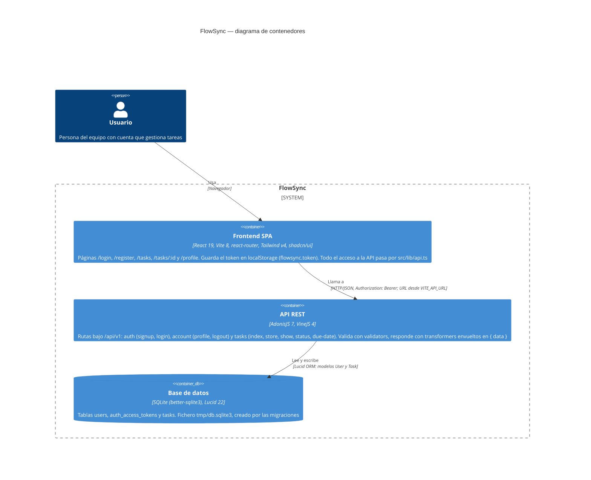

# Arquitectura de FlowSync

Diagrama de contenedores (nivel 2 del modelo C4) del estado actual del código: una SPA de React que habla con una API REST de AdonisJS bajo `/api/v1`, la cual persiste en una base de datos SQLite local. Solo aparece lo verificado en el repositorio; no hay servicios externos, colas ni cachés porque no existen en el código.

## Componentes que sostienen el diagrama

| Contenedor | Dónde está en el código |
|---|---|
| Frontend SPA | `frontend/src/` — `pages/`, `routes/` (guards `protected-route` y `public-only-route`), `auth/`, `lib/api.ts` |
| API REST | `backend/start/routes.ts`, `backend/app/controllers/`, `validators/`, `transformers/`, `middleware/` |
| Base de datos | `backend/config/database.ts`, `backend/database/migrations/`, modelos en `backend/app/models/` |

Autenticación: el guard por defecto es `api` (access tokens opacos persistidos en `auth_access_tokens`); las rutas `account/*` y `tasks/*` se protegen con `middleware.auth()`.
